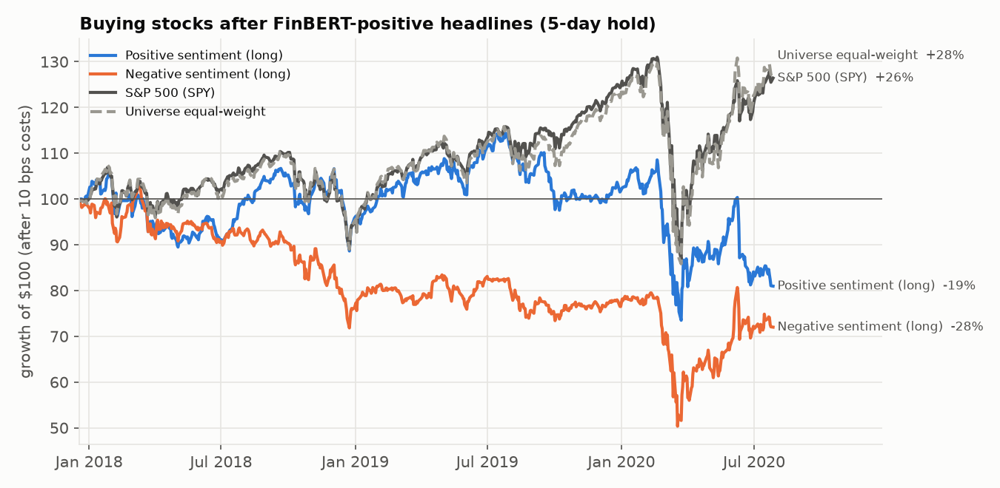
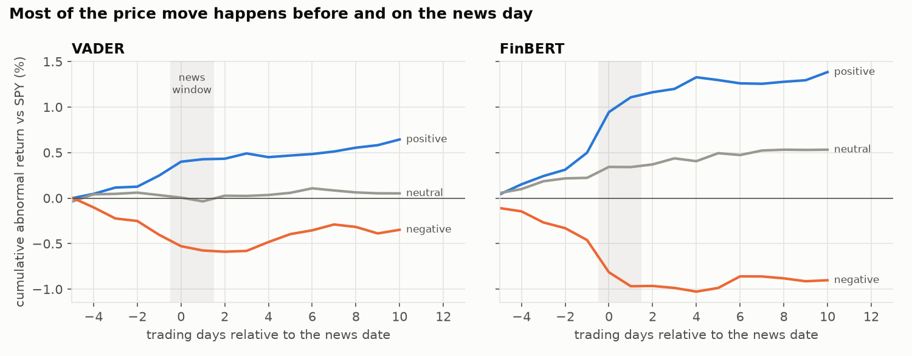
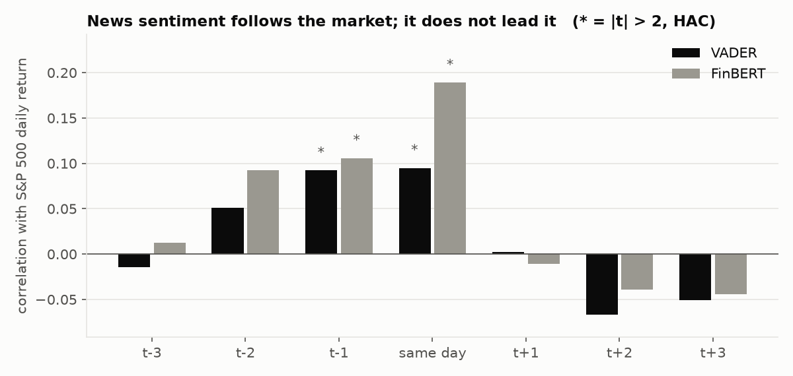

# Can Positive News Sentiment Pick Stocks?

**An honest test of the "buy what the headlines love" strategy on 53,000 financial news headlines (Dec 2017 – Jul 2020), using two sentiment models: VADER and FinBERT.**

This project started as a simple idea: score news headlines for sentiment and buy the stocks with the most positive coverage. This version turns that into a proper experiment. It links headlines to companies, measures sentiment with a general-purpose model and a finance-specific model, lines everything up with real prices without look-ahead bias, and asks whether the signal makes money after costs.

**Short answer: no. The reason why is the interesting part.**



## TL;DR: findings

| # | Finding | Evidence |
|---|---------|----------|
| 1 | **Sentiment explains price moves, and the finance-specific model does it far better.** FinBERT separates positive from negative news by **0.80% on the news day** (t = 10.3). VADER manages 0.28% (t = 3.3). | Event study |
| 2 | **But the move happens before or on the news day.** From the next open, positive-news stocks earn −4 bps (FinBERT) or −8 bps (VADER) the following session. A trader reading the headline is already too late. | Event study |
| 3 | **After the news, neither model gives a reliable edge.** Over 5–20 days VADER points to a *reversal* (negative news outperforms) and FinBERT to mild *continuation*. Neither result holds up across both models, which is the signature of noise. | Event study |
| 4 | **"Buy positive news" lost money with both models:** −19% (FinBERT) and −36% (VADER) total return vs. +26% for the S&P 500. Alpha after 10 bps costs was **−16%/yr** and **−25%/yr**. Before costs FinBERT is roughly break-even (−0.3%/yr), so trading costs alone sink it. | Backtest |
| 5 | **Market-wide sentiment is a lagging indicator.** The daily tone of the news correlates with *today's* S&P 500 return (FinBERT ρ = 0.19, t = 4.2) and *yesterday's* (ρ = 0.11), but not at all with *tomorrow's* (ρ = −0.01). The news describes the market; it doesn't predict it. | Lead/lag analysis |
| 6 | **Machine learning on headline text can't beat a coin flip on future returns.** A TF-IDF + logistic regression model scores 49.5% on next-day direction (AUC 0.49), against 54–55% on the *same-day* move. The text describes moves that have already happened. | Text classifier |

The bottom line is a textbook demonstration of semi-strong market efficiency for large, heavily covered US stocks. **A better sentiment model measures the news more accurately, but that doesn't make it more profitable**, because by the time sentiment is visible in a published headline, it is in the price.

---

## The question

> If a stock gets positive news coverage today, does it outperform the market over the following days, by enough to trade on?

That splits into testable pieces:

1. **Reaction:** do prices move in the direction of the sentiment at all? (Sanity check: if not, the sentiment measure is broken.)
2. **Predictability:** after the news is public, is there still a drift we could capture?
3. **Tradeability:** does a realistic strategy beat the market after costs?
4. **Direction of causality:** does sentiment lead prices, or follow them?
5. **Model quality:** does a finance-specific language model (FinBERT) change any of the answers compared with a generic lexicon (VADER)?

## Data

| Source | Headlines | Coverage | Fields |
|--------|----------:|----------|--------|
| Reuters | 32,691 | Mar 2018 – Jul 2020 | headline, date, one-line summary |
| The Guardian (business) | 17,760 | Dec 2017 – Jul 2020 | headline, date |
| CNBC | 2,791 | Dec 2017 – Jul 2020 | headline, timestamp, summary |

Prices are daily split- and dividend-adjusted open/close prices from Yahoo Finance for 79 large US stocks plus SPY as the market benchmark.

## Method

```
headlines ──► company linking ──► sentiment score ──► align with prices ──► tests
 (53k)        (12.4k mentions,     VADER + FinBERT      no look-ahead        event study
               79 tickers)                                                   lead/lag
                                                                             backtest
                                                                             text classifier
```

**1. Company linking** ([`src/entities.py`](src/entities.py)). Uses a hand-curated alias table (for example, "Boeing" or "737 MAX" → BA, and "Facebook", "Instagram" or "WhatsApp" → META) matched with case-sensitive, word-bounded regexes. Precision was prioritised over recall: ambiguous names like *Target*, *Visa*, *Gap* and *Shell* are excluded. Phrases like "Amazon rainforest", "Oracle of Omaha" and "Notting Hill Carnival" are explicitly guarded against. The most-covered names are Boeing (1,370 mentions), Amazon, Apple, Tesla and Facebook.

**2. Sentiment** ([`src/sentiment.py`](src/sentiment.py)). Two scorers:
- **VADER**, a fast rule/lexicon model built for social media. It doesn't know that "shares fall" is bad or that "liability" is neutral in finance.
- **FinBERT** (`ProsusAI/finbert`), a BERT model fine-tuned on financial text. Score = P(positive) − P(negative).

Headlines are bucketed as *positive* (> 0.3), *negative* (< −0.3) or *neutral*. These thresholds were fixed in advance, not tuned on results.

**3. Timing: the part most sentiment studies get wrong** ([`src/analysis.py`](src/analysis.py)). Reuters and Guardian headlines have a date but **no time of day**, so a headline dated Monday could have come out at 8am or 8pm. To avoid look-ahead bias:
- **Reaction** is measured from close(t₀−1) to close(t₀), where t₀ is the news date. It is descriptive only.
- **Every tradeable return starts at the open of the next session** after the news date (t₁). A trader reading Monday's news could act at Tuesday's open at the earliest.

All returns are **market-adjusted** (stock minus SPY). Standard errors are **clustered by date**, because 30 stocks reacting to the same COVID headline are not 30 independent observations.

**4. Backtest.** Each day, buy (equal-weight) every stock whose average headline sentiment over the last 5 sessions is positive. Enter at the open, mark to the close, rebalance daily, and charge 10 bps per trade. Benchmarks are SPY, an equal-weight portfolio of the whole 79-stock universe (to separate stock-picking from just owning big tech), and an "any news" portfolio that buys every stock in the news regardless of tone (to separate sentiment from attention).

## Results

### 1–3. Event study: prices move first, then the trail goes cold



Mean market-adjusted return in basis points (t-stat clustered by date), 8,059 stock-day events:

**FinBERT** (2,273 positive · 2,474 neutral · 3,312 negative)

| Bucket | News day (reaction) | Next session | Next 5 | Next 10 | Next 20 |
|--------|------:|------:|------:|------:|------:|
| Positive | **+44.6** (7.73) | −3.8 (−0.92) | +17.8 (1.75) | +22.5 (1.58) | +43.0 (2.19) |
| Neutral | +12.0 (2.31) | −8.4 (−2.32) | +6.0 (0.62) | +8.9 (0.72) | +32.4 (1.87) |
| Negative | **−35.4** (−6.10) | −1.2 (−0.28) | +0.4 (0.03) | −1.0 (−0.08) | −0.0 (−0.00) |
| **Positive − negative** | **+80.0** (10.3) | −2.6 (−0.46) | +17.3 (1.11) | +23.6 (1.27) | +43.0 (1.70) |

**VADER** (2,919 positive · 3,459 neutral · 1,681 negative)

| Bucket | News day (reaction) | Next session | Next 5 | Next 10 | Next 20 |
|--------|------:|------:|------:|------:|------:|
| Positive | **+15.2** (2.90) | −7.9 (−2.23) | −3.5 (−0.33) | +8.8 (0.68) | +7.9 (0.45) |
| Neutral | −2.7 (−0.52) | −5.1 (−1.32) | +7.4 (0.73) | +0.5 (0.04) | +8.1 (0.46) |
| Negative | **−12.5** (−1.76) | +4.3 (0.77) | +24.5 (1.78) | +25.2 (1.42) | **+75.5** (2.87) |
| **Positive − negative** | **+27.7** (3.31) | −12.2 (−1.94) | −28.0 (−1.78) | −16.4 (−0.78) | **−67.6** (−2.21) |

Reading across the rows:
- **Both sentiment measures work, and FinBERT is about 3× sharper.** Its news-day spread is 80 bps with a t-stat above 10. VADER mislabels many financial headlines: it flags fewer than half as many negative events, because phrases like "shares fall" or "cuts forecast" carry no negative words in a social-media lexicon.
- **The chart shows drift *before* day 0.** Prices start moving several days before the headline is dated. Some of that is information leaking into prices, and some is that headlines often *report* a move ("shares jump after…").
- **The next session, the one you could actually trade, is flat or negative for both models.**
- **The longer horizons disagree.** VADER shows a significant 20-day *reversal* (t = −2.2), while FinBERT shows a borderline *continuation* (t = 1.7). With two models pointing in opposite directions on the same headlines, neither result should be trusted. This is exactly the kind of finding that would look like a discovery if only one model had been run.

### 4. Backtest: buying good news lost money

| Strategy | Model | Total return | Sharpe | Gross alpha/yr | Net alpha/yr (t) | Max drawdown |
|----------|-------|------:|------:|------:|------:|------:|
| **Positive sentiment (long)** | FinBERT | **−19.0%** | −0.21 | −0.3% | **−15.9%** (−2.09) | −35.8% |
| **Positive sentiment (long)** | VADER | **−35.9%** | −0.52 | −10.8% | **−25.3%** (−3.52) | −49.2% |
| Negative sentiment (long) | FinBERT | −28.0% | −0.33 | −7.0% | −20.9% (−2.80) | −51.1% |
| Negative sentiment (long) | VADER | −13.2% | −0.07 | +5.0% | −12.5% (−1.28) | −49.2% |
| Long positive / short negative | FinBERT | +6.0% | 0.22 | +6.7% | +5.1% (0.51) | −30.7% |
| Long positive / short negative | VADER | −29.9% | −0.61 | −15.8% | −12.9% (−1.03) | −45.9% |
| Any news (long) | – | +3.9% | 0.19 | −1.0% | −7.7% (−1.51) | −35.6% |
| Universe equal-weight | – | +28.0% | 0.50 | +0.3% | +0.3% (0.09) | −33.8% |
| S&P 500 (SPY) | – | +26.4% | 0.50 | – | – | −33.7% |

Jan 2018 – Jul 2020, 5-day holding window, 10 bps one-way costs. Alpha is from a CAPM regression on SPY with HAC standard errors. Full tables: [`results/backtest_finbert.csv`](results/backtest_finbert.csv), [`results/backtest_vader.csv`](results/backtest_vader.csv).

Three things stand out:
- **Neither model's "buy positive news" portfolio beats the market.** Both trail SPY by a wide margin after costs.
- **FinBERT's long-short is the only positive line** (+5.1%/yr), but with t = 0.51 it is statistically indistinguishable from zero. It also lost money in 2020 (Sharpe −1.21).
- **Costs are the silent killer.** A strategy that reacts to the news cycle turns over a large part of the book every day. At just 10 bps per trade, that is about 15 percentage points of drag per year. It is the difference between break-even and −16% for FinBERT.

The result also holds **year by year**. The FinBERT positive-sentiment strategy had a Sharpe ratio of −0.11 in 2018, 0.47 in 2019 (still well below SPY's 2.24) and −0.80 in 2020.

<details>
<summary>VADER backtest chart</summary>


</details>

### 5. Market sentiment follows the market




Averaging every headline into one daily "mood of the news" index gives a clear picture. It collapsed during the COVID crash and drifted back up with the recovery. But the lead/lag chart shows *when*: sentiment correlates with **yesterday's and today's** market return and has no correlation with **tomorrow's**, under both models. FinBERT's same-day correlation (0.19) is twice VADER's (0.095), which again shows it reads financial news better, but neither has any predictive value. Journalists write about what the market just did.

### 6. A text classifier can't predict tomorrow either

The original version of this repo trained a Naive Bayes model on headline text. Here it is again, done properly: predict whether the stock beats the market, with a **chronological** train/test split (first 70% of dates train, last 30% test).

| Model | Same-day move (not tradeable) | Next session | Next 5 sessions |
|-------|------:|------:|------:|
| Majority class baseline | 53.0% | 52.2% | 52.2% |
| Naive Bayes (TF-IDF) | **54.8%** (AUC 0.55) | 50.0% | 50.2% |
| Logistic regression (TF-IDF, 1–2-grams) | 54.1% (AUC 0.54) | 49.5% | 49.6% |
| FinBERT score only | 51.6% (AUC 0.54) | 49.5% (AUC 0.50) | 51.3% (AUC 0.52) |
| VADER score only | 51.1% (AUC 0.52) | 49.3% (AUC 0.49) | 49.2% (AUC 0.49) |

The text carries real information about the move that is **already happening** but nothing about what comes next. That is the cleanest single-number summary of the whole project.

### VADER vs FinBERT at a glance

| Metric | VADER | FinBERT | Winner |
|--------|------:|------:|:------:|
| News-day positive − negative spread | 28 bps (t = 3.3) | **80 bps (t = 10.3)** | FinBERT |
| Same-day correlation with S&P 500 | 0.095 | **0.189** | FinBERT |
| Same-day classifier AUC (score only) | 0.519 | **0.535** | FinBERT |
| Next-session positive − negative spread | −12 bps (t = −1.9) | −3 bps (t = −0.5) | neither |
| Next-day correlation with S&P 500 | 0.003 | −0.011 | neither |
| "Buy positive news" net alpha | −25.3%/yr | −15.9%/yr | neither |

**FinBERT is clearly the better *measurement* tool, and it is no better as a *forecasting* tool.** Measuring the news more accurately doesn't help when the market has already done the same job.

### Bonus: the "buy list" in action

[`results/screen_vader.csv`](results/screen_vader.csv) and [`results/screen_finbert.csv`](results/screen_finbert.csv) show what the screen recommended using news up to **17 Jul 2020** (the last day in the data). Each is held from the 20 Jul open to the 14 Aug close. With VADER:

- Top-10 most positive: BRK-B, MRNA, FDX, GS, UAL, ZM, GILD, NVDA, WFC, WMT. **Average excess return vs SPY: −2.3%.** FedEx +22% and Moderna −26% show how noisy single picks are.
- Bottom-10 most negative: **average excess return vs SPY: +0.5%.**

FinBERT's top-10 (led by NVDA, GILD, GS and MRNA) averaged **−3.2%** vs SPY. That is one month and one anecdote, not evidence, but it points the same way as everything above.

## What changed from the original script

The original `datamining.py` (still in git history) had a fundamental bug. It used each **headline as the class label** and tried to predict it from the description. Every headline is unique, so the classifier was choosing between ~2,800 classes it had mostly seen once, and the accuracy number meant nothing. It also never computed sentiment, never looked at stock prices, and only used one of the three datasets.

| Before | After |
|--------|-------|
| 1 dataset (CNBC, 2.8k rows) | All 3 sources, 53k headlines, cleaned and deduplicated |
| No sentiment model | VADER and FinBERT, compared head to head |
| No link to companies | 12.4k headline→ticker links across 79 stocks |
| No prices | Adjusted daily prices, market-adjusted returns |
| Random train/test split | Chronological split (no peeking at the future) |
| Label = the headline itself | Label = did the stock beat the market? |
| "Accuracy" | Clustered t-stats, a costed backtest, CAPM alpha, year-by-year and cross-model robustness |

## Limitations and threats to validity

- **Date-only timestamps.** Without intraday times, I can't test whether a high-frequency trader reading Reuters at 9:31am could profit. Professional sentiment funds compete in that window, measured in seconds to minutes. This study tests whether an end-of-day reader can profit; the answer is no.
- **Survivorship bias.** The universe is stocks that still trade today, because Yahoo no longer serves delisted names (Twitter, Celgene, Walgreens). This *helps* the strategies, so the negative result is conservative.
- **Universe.** These are 79 mega-caps, the most analysed stocks in the world. Sentiment effects are documented to be stronger in small caps with less analyst coverage.
- **Sample period.** Two and a half years, dominated by a historic crash and rebound. The year-by-year breakdown helps, but it is still a short window.
- **Multiple comparisons.** Many horizons, buckets and two models are reported. Isolated t ≈ 2 results (like either model's 20-day effect) are what you'd expect by chance in a table this size. Running two models exposed this directly: their 20-day effects point in opposite directions.
- **Simple abnormal returns.** Returns are stock minus SPY, not a beta-adjusted or Fama-French model. High-beta stocks will look noisier in crashes.
- **FinBERT on headlines.** FinBERT was trained on sentences from financial reports, not headlines. It still clearly outperforms VADER here, but a model fine-tuned on headlines could do better at *measuring* sentiment, though the results above suggest that wouldn't make it predictive.

## Run it yourself

```bash
python -m venv .venv
.venv/Scripts/activate            # Windows  (source .venv/bin/activate on macOS/Linux)
pip install -r requirements.txt

python run_analysis.py --models vader     # ~1 minute

# FinBERT comparison (CPU-heavy: ~60 minutes on an 8-core laptop the first time,
# then cached; progress is checkpointed so an interrupted run resumes):
pip install torch --index-url https://download.pytorch.org/whl/cpu
pip install transformers
python run_analysis.py                    # runs VADER and FinBERT
```

Useful flags: `--hold 10` (backtest holding period) and `--screen-date 2019-06-28` (date for the buy-list screen).

All tables are written to [`results/`](results/), the full numeric report to [`results/RESULTS.md`](results/RESULTS.md), and the charts to [`results/figures/`](results/figures/). Sentiment scores and prices are cached in `cache/`.

## Repository layout

```
├── run_analysis.py        # entry point: runs the whole pipeline
├── src/
│   ├── data.py            # load + clean the three headline datasets
│   ├── entities.py        # headline → ticker linking
│   ├── sentiment.py       # VADER and FinBERT scoring (cached, resumable)
│   ├── prices.py          # Yahoo Finance prices (cached)
│   ├── analysis.py        # event study, lead/lag, backtest, classifier, screen
│   └── plots.py           # figures
├── results/               # generated tables, RESULTS.md, figures/
├── cnbc_headlines.csv
├── guardian_headlines.csv
└── reuters_headlines.csv
```

## Where to take it next

- **Intraday timestamps** (e.g. GDELT or a news API with timestamps) to test the first 5–60 minutes after publication, where any edge would live.
- **Small and mid caps**, where analyst coverage is thin and news travels slower.
- **Surprise rather than level:** sentiment *relative to what was expected* (e.g. vs. the stock's recent coverage), which matches how earnings surprises are modelled.
- **Out-of-sample check of the long-horizon effects** on 2021+ data, to settle whether VADER's reversal or FinBERT's continuation is real (most likely neither).

## References

- Tetlock, P. (2007). *Giving Content to Investor Sentiment: The Role of Media in the Stock Market.* Journal of Finance.
- Loughran, T. & McDonald, B. (2011). *When Is a Liability Not a Liability?* Journal of Finance.
- Araci, D. (2019). *FinBERT: Financial Sentiment Analysis with Pre-trained Language Models.*
- Hutto, C. & Gilbert, E. (2014). *VADER: A Parsimonious Rule-based Model for Sentiment Analysis of Social Media Text.*
