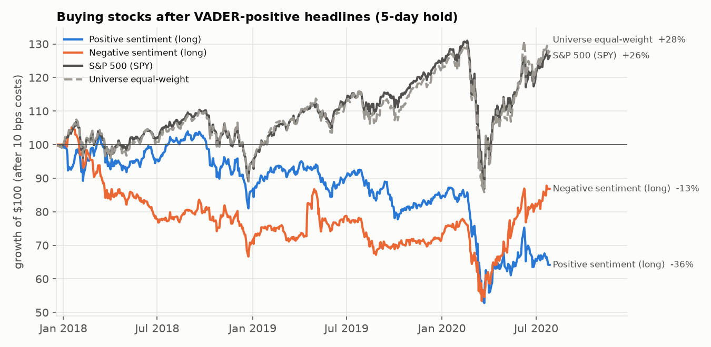
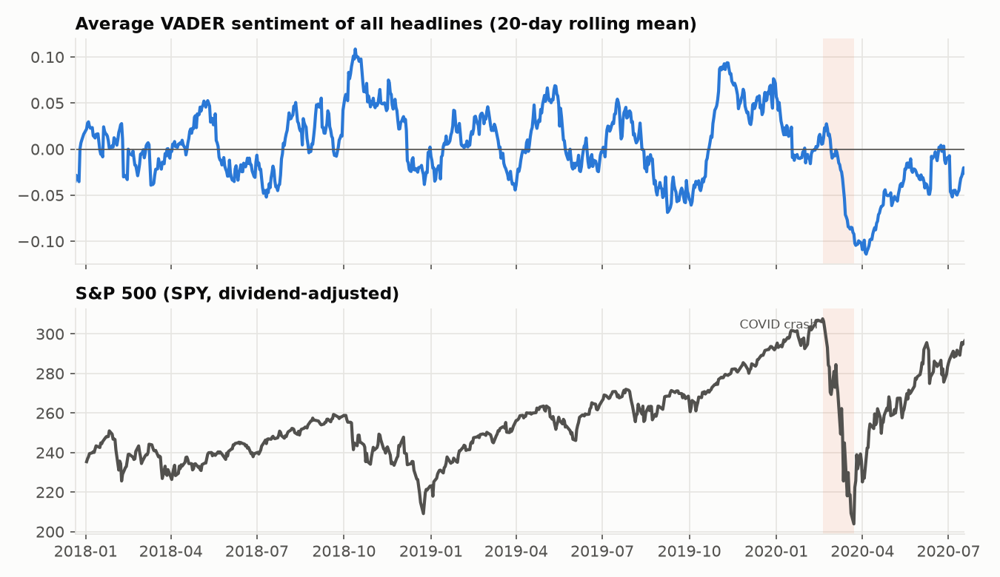

# Can Positive News Sentiment Pick Stocks?

**An honest test of the "buy what the headlines love" strategy on 53,000 financial news headlines (Dec 2017 – Jul 2020).**

This project started as a simple idea: score news headlines for sentiment and buy the stocks with the most positive coverage. This version turns that into a proper experiment. It links headlines to companies, measures sentiment, lines everything up with real prices without look-ahead bias, and asks whether the signal makes money after costs.

**Short answer: no. The reason why is the interesting part.**



## TL;DR: findings

| # | Finding | Evidence |
|---|---------|----------|
| 1 | **Headline sentiment tracks prices, but the move happens before or on the news day.** Stocks with positive coverage beat the market by **+15 bps on the news day** (t = 2.9). Negative coverage sees −12 bps. Most of that is already in the price by the time a headline can be traded. | Event study, [`results/RESULTS.md`](results/RESULTS.md) |
| 2 | **There is no positive drift to harvest afterwards.** From the next open, positive-news stocks earn −8 bps the next day and roughly zero over 5–20 days. | Event study |
| 3 | **If anything, sentiment reverses.** Stocks with *negative* headlines outperformed positive ones by **0.68% over the following 20 trading days** (t = 2.2). This is consistent with investors overreacting to bad news, as Tetlock (2007) also found. | Event study |
| 4 | **The "buy positive news" strategy lost money:** −36% total return vs. +26% for the S&P 500, with a CAPM alpha of **−25%/yr (t = −3.5)** after 10 bps costs. Even before costs alpha is −11%/yr. Trading costs eat roughly 14 points a year because a news-driven book turns over constantly. | Backtest |
| 5 | **Market-wide sentiment is a lagging indicator.** Daily average news tone correlates with *today's* and *yesterday's* S&P 500 return (ρ ≈ 0.09, significant) but has zero correlation with *tomorrow's* (ρ = 0.003). The news describes the market; it doesn't predict it. | Lead/lag analysis |
| 6 | **Machine learning on headline text can't beat a coin flip on future returns.** A TF-IDF + logistic regression model scores 49.5% accuracy (AUC 0.49) on next-day direction. The same model gets 54–55% on the *same-day* move, which confirms the text describes price moves that have already happened. | Text classifier |

The bottom line is a textbook demonstration of semi-strong market efficiency for large, heavily covered US stocks. By the time sentiment is visible in a published headline, it is in the price.

---

## The question

> If a stock gets positive news coverage today, does it outperform the market over the following days, by enough to trade on?

That splits into testable pieces:

1. **Reaction:** do prices move in the direction of the sentiment at all? (Sanity check: if not, the sentiment measure is broken.)
2. **Predictability:** after the news is public, is there still a drift we could capture?
3. **Tradeability:** does a realistic strategy beat the market after costs?
4. **Direction of causality:** does sentiment lead prices, or follow them?

## Data

| Source | Headlines | Coverage | Fields |
|--------|----------:|----------|--------|
| Reuters | 32,691 | Mar 2018 – Jul 2020 | headline, date, one-line summary |
| The Guardian (business) | 17,760 | Dec 2017 – Jul 2020 | headline, date |
| CNBC | 2,791 | Dec 2017 – Jul 2020 | headline, timestamp, summary |

Prices are daily split- and dividend-adjusted open/close prices from Yahoo Finance for 79 large US stocks plus SPY as the market benchmark.

## Method

```
headlines ──► company linking ──► sentiment score ──► align with prices ──► tests
 (53k)        (12.4k mentions,     VADER / FinBERT      no look-ahead        event study
               79 tickers)                                                   lead/lag
                                                                             backtest
                                                                             text classifier
```

**1. Company linking** ([`src/entities.py`](src/entities.py)). Uses a hand-curated alias table (for example, "Boeing" or "737 MAX" → BA, and "Facebook", "Instagram" or "WhatsApp" → META) matched with case-sensitive, word-bounded regexes. Precision was prioritised over recall: ambiguous names like *Target*, *Visa*, *Gap* and *Shell* are excluded. Phrases like "Amazon rainforest", "Oracle of Omaha" and "Notting Hill Carnival" are explicitly guarded against. The most-covered names are Boeing (1,370 mentions), Amazon, Apple, Tesla and Facebook.

**2. Sentiment** ([`src/sentiment.py`](src/sentiment.py)). Two scorers are compared:
- **VADER**, a fast lexicon model built for social media. It is the baseline.
- **FinBERT** (`ProsusAI/finbert`), a BERT model fine-tuned on financial text. Score = P(positive) − P(negative).

Headlines are bucketed as *positive* (> 0.3), *negative* (< −0.3) or *neutral*. These thresholds were fixed in advance, not tuned on results.

**3. Timing: the part most sentiment studies get wrong** ([`src/analysis.py`](src/analysis.py)). Reuters and Guardian headlines have a date but **no time of day**, so a headline dated Monday could have come out at 8am or 8pm. To avoid look-ahead bias:
- **Reaction** is measured from close(t₀−1) to close(t₀), where t₀ is the news date. It is descriptive only.
- **Every tradeable return starts at the open of the next session** after the news date (t₁). A trader reading Monday's news could act at Tuesday's open at the earliest.

All returns are **market-adjusted** (stock minus SPY). Standard errors are **clustered by date**, because 30 stocks reacting to the same COVID headline are not 30 independent observations.

**4. Backtest.** Each day, buy (equal-weight) every stock whose average headline sentiment over the last 5 sessions is positive. Enter at the open, mark to the close, rebalance daily, and charge 10 bps per trade. Benchmarks are SPY, an equal-weight portfolio of the whole 79-stock universe (to separate stock-picking from just owning big tech), and an "any news" portfolio that buys every stock in the news regardless of tone (to separate sentiment from attention).

## Results

### 1–3. Event study: prices move first, then reverse


Mean market-adjusted return in basis points (t-stat clustered by date), VADER sentiment, 8,059 stock-day events:

| Bucket | News day (reaction) | Next session | Next 5 | Next 10 | Next 20 |
|--------|------:|------:|------:|------:|------:|
| Positive (n = 2,919) | **+15.2** (2.90) | −7.9 (−2.23) | −3.5 (−0.33) | +8.8 (0.68) | +7.9 (0.45) |
| Neutral (n = 3,459) | −2.7 (−0.52) | −5.1 (−1.32) | +7.4 (0.73) | +0.5 (0.04) | +8.1 (0.46) |
| Negative (n = 1,681) | **−12.5** (−1.76) | +4.3 (0.77) | +24.5 (1.78) | +25.2 (1.42) | **+75.5** (2.87) |
| **Positive − negative** | **+27.7** (3.31) | −12.2 (−1.94) | −28.0 (−1.78) | −16.4 (−0.78) | **−67.6** (−2.21) |

Reading across the rows:
- **The sentiment measure works.** Positive and negative headlines line up with a 28 bps spread on the news day.
- **The chart shows drift *before* day 0.** Prices start moving several days before the headline is dated. Some of that is information leaking into prices, and some is that headlines often *report* a move ("shares jump after…").
- **After the news, the sign flips.** Negative-news stocks recover, and the positive-minus-negative spread becomes significantly *negative* at 20 days. That is the opposite of what a "buy positive news" strategy needs.

### 4. Backtest: buying good news lost money

| Strategy | Total return | Sharpe | Gross alpha/yr | Net alpha/yr (t) | Max drawdown |
|----------|------:|------:|------:|------:|------:|
| **Positive sentiment (long)** | **−35.9%** | −0.52 | −10.8% | **−25.3%** (−3.52) | −49.2% |
| Negative sentiment (long) | −13.2% | −0.07 | +5.0% | −12.5% (−1.28) | −49.2% |
| Any news (long) | +3.9% | 0.19 | −1.0% | −7.7% (−1.51) | −35.6% |
| Long positive / short negative | −29.9% | −0.61 | −15.8% | −12.9% (−1.03) | −45.9% |
| Universe equal-weight | +28.0% | 0.50 | +0.3% | +0.3% (0.09) | −33.8% |
| S&P 500 (SPY) | +26.4% | 0.50 | – | – | −33.7% |

Jan 2018 – Jul 2020, 5-day holding window, 10 bps one-way costs. Alpha is from a CAPM regression on SPY with HAC standard errors.

Two things stand out:
- **Before costs, buying *negative* news beat buying positive news** (+5.0% vs −10.8% alpha). This is the same reversal effect the event study shows.
- **Costs are the silent killer.** A strategy that reacts to the news cycle turns over a large part of the book every day. At just 10 bps per trade, that is about 14 percentage points of drag per year.

The result also holds **year by year**. The positive-sentiment strategy had a negative Sharpe ratio in 2018 (−0.64), 2019 (−0.09) and 2020 (−0.80), so this isn't just a COVID artefact.

### 5. Market sentiment follows the market




Averaging every headline into one daily "mood of the news" index gives a clear picture. It collapsed during the COVID crash and drifted back up with the recovery. But the lead/lag chart shows *when*: sentiment correlates with **yesterday's and today's** market return (t ≈ 2.1 and 2.8) and has zero correlation with **tomorrow's** (ρ = 0.003, t = 0.06). Journalists write about what the market just did.

### 6. A text classifier can't predict tomorrow either

The original version of this repo trained a Naive Bayes model on headline text. Here it is again, done properly: predict whether the stock beats the market, with a **chronological** train/test split (first 70% of dates train, last 30% test).

| Model | Same-day move (not tradeable) | Next session | Next 5 sessions |
|-------|------:|------:|------:|
| Majority class baseline | 52.9% | 52.2% | 52.2% |
| Naive Bayes (TF-IDF) | **54.7%** (AUC 0.55) | 50.0% | 50.2% |
| Logistic regression (TF-IDF, 1–2-grams) | 54.0% (AUC 0.54) | 49.5% | 49.6% |
| Sentiment score only | 51.1% | 49.3% | 49.2% |

The text carries real information about the move that is **already happening** but nothing about what comes next. That is the cleanest single-number summary of the whole project.

### Bonus: the "buy list" in action

[`results/screen_vader.csv`](results/screen_vader.csv) shows what the screen recommended using news up to **17 Jul 2020** (the last day in the data). It is held from the 20 Jul open to the 14 Aug close:

- Top-10 most positive: BRK-B, MRNA, FDX, GS, UAL, ZM, GILD, NVDA, WFC, WMT. **Average excess return vs SPY: −2.3%.** FedEx +22% and Moderna −26% show how noisy single picks are.
- Bottom-10 most negative: SBUX, VZ, CRM, META, BAC, GM, PEP, MSFT, NFLX, DAL. **Average excess return vs SPY: +0.5%.**

That is one month and one anecdote, not evidence, but it points the same way as everything above.

## What changed from the original script

The original `datamining.py` (still in git history) had a fundamental bug. It used each **headline as the class label** and tried to predict it from the description. Every headline is unique, so the classifier was choosing between ~2,800 classes it had mostly seen once, and the accuracy number meant nothing. It also never computed sentiment, never looked at stock prices, and only used one of the three datasets.

| Before | After |
|--------|-------|
| 1 dataset (CNBC, 2.8k rows) | All 3 sources, 53k headlines, cleaned and deduplicated |
| No sentiment model | VADER (results above), with FinBERT supported via `run_analysis.py` |
| No link to companies | 12.4k headline→ticker links across 79 stocks |
| No prices | Adjusted daily prices, market-adjusted returns |
| Random train/test split | Chronological split (no peeking at the future) |
| Label = the headline itself | Label = did the stock beat the market? |
| "Accuracy" | Clustered t-stats, a costed backtest, CAPM alpha, year-by-year robustness |

## Limitations and threats to validity

- **Date-only timestamps.** Without intraday times, I can't test whether a high-frequency trader reading Reuters at 9:31am could profit. Professional sentiment funds compete in that window, measured in seconds to minutes. This study tests whether an end-of-day reader can profit; the answer is no.
- **Survivorship bias.** The universe is stocks that still trade today, because Yahoo no longer serves delisted names (Twitter, Celgene, Walgreens). This *helps* the strategies, so the negative result is conservative.
- **Universe.** These are 79 mega-caps, the most analysed stocks in the world. Sentiment effects are documented to be stronger in small caps with less analyst coverage.
- **Sample period.** Two and a half years, dominated by a historic crash and rebound. The year-by-year breakdown helps, but it is still a short window.
- **Multiple comparisons.** Several horizons and buckets are reported. The reversal at 20 days (t = 2.2) is suggestive, not conclusive, and should be confirmed on fresh data before being traded.
- **Simple abnormal returns.** Returns are stock minus SPY, not a beta-adjusted or Fama-French model. High-beta stocks will look noisier in crashes.

## Run it yourself

```bash
python -m venv .venv
.venv/Scripts/activate            # Windows  (source .venv/bin/activate on macOS/Linux)
pip install -r requirements.txt

python run_analysis.py --models vader     # ~1 minute
# Optional FinBERT comparison (CPU-heavy, ~30+ minutes the first time, then cached):
pip install torch --index-url https://download.pytorch.org/whl/cpu
pip install transformers
python run_analysis.py                    # runs VADER and FinBERT
```

Useful flags: `--hold 10` (backtest holding period) and `--screen-date 2019-06-28` (date for the buy-list screen).

All tables are written to [`results/`](results/), the full numeric report to [`results/RESULTS.md`](results/RESULTS.md), and the charts to [`results/figures/`](results/figures/). Sentiment scores and prices are cached in `cache/`.

## Repository layout

```
├── run_analysis.py        # entry point: runs the whole pipeline
├── src/
│   ├── data.py            # load + clean the three headline datasets
│   ├── entities.py        # headline → ticker linking
│   ├── sentiment.py       # VADER and FinBERT scoring (cached)
│   ├── prices.py          # Yahoo Finance prices (cached)
│   ├── analysis.py        # event study, lead/lag, backtest, classifier, screen
│   └── plots.py           # figures
├── results/               # generated tables, RESULTS.md, figures/
├── cnbc_headlines.csv
├── guardian_headlines.csv
└── reuters_headlines.csv
```

## Where to take it next

- **Intraday timestamps** (e.g. GDELT or a news API with timestamps) to test the first 5–60 minutes after publication, where any edge would live.
- **Small and mid caps**, where analyst coverage is thin and news travels slower.
- **Surprise rather than level:** sentiment *relative to what was expected* (e.g. vs. the stock's recent coverage), which matches how earnings surprises are modelled.
- **Exploit the reversal:** a formal test of a "buy the negative-news overreaction" strategy on out-of-sample data (2021+).

## References

- Tetlock, P. (2007). *Giving Content to Investor Sentiment: The Role of Media in the Stock Market.* Journal of Finance.
- Loughran, T. & McDonald, B. (2011). *When Is a Liability Not a Liability?* Journal of Finance.
- Araci, D. (2019). *FinBERT: Financial Sentiment Analysis with Pre-trained Language Models.*
- Hutto, C. & Gilbert, E. (2014). *VADER: A Parsimonious Rule-based Model for Sentiment Analysis of Social Media Text.*
